# Poly Haven: Textiles & Leather textures

**19 assets from [Poly Haven](https://polyhaven.com), dedicated to the public domain under [CC0](https://polyhaven.com/license).** Use them in any game, free or paid, and change them however you like; no credit is needed.

PBR textures as 1K and 2K JPG maps (colour, normal (GL and DX), roughness, AO, displacement and more). 893.6 MB in all.

This is a copy kept by [zuujis-cc0](https://github.com/zuujis-cc0) so game makers can take single files from GitHub. It is not made by or affiliated with Poly Haven: the originals, often in more formats and higher resolutions, are on [polyhaven.com](https://polyhaven.com). If they help you, consider [supporting Poly Haven](https://www.patreon.com/polyhaven/overview).

Every file is listed in [MANIFEST.tsv](MANIFEST.tsv) with its size and SHA-256. More free assets: [the Zuujis collection](https://github.com/zuujis-cc0/free-game-assets#readme).

| | | | |
| :-: | :-: | :-: | :-: |
| <a href="hessian_230">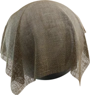</a> <b><a href="hessian_230">Hessian 230</a></b> by Rico Cilliers, colormass · <a href="https://polyhaven.com/a/hessian_230">source</a> | <a href="hessian_380">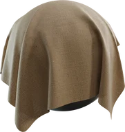</a> <b><a href="hessian_380">Hessian 380</a></b> by Rico Cilliers, colormass · <a href="https://polyhaven.com/a/hessian_380">source</a> | <a href="jersey_melange">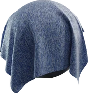</a> <b><a href="jersey_melange">Jersey Melange</a></b> by Rico Cilliers, colormass · <a href="https://polyhaven.com/a/jersey_melange">source</a> | <a href="jogging_melange">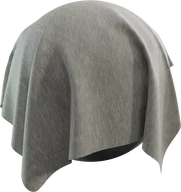</a> <b><a href="jogging_melange">Jogging Melange</a></b> by Rico Cilliers, colormass · <a href="https://polyhaven.com/a/jogging_melange">source</a> |
| <a href="knitted_fleece">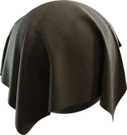</a> <b><a href="knitted_fleece">Knitted Fleece</a></b> by Rico Cilliers, colormass · <a href="https://polyhaven.com/a/knitted_fleece">source</a> | <a href="leather_red_02">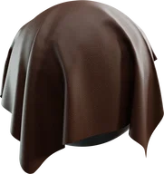</a> <b><a href="leather_red_02">Leather Red 02</a></b> by Rob Tuytel · <a href="https://polyhaven.com/a/leather_red_02">source</a> | <a href="leather_red_03">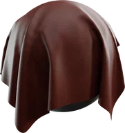</a> <b><a href="leather_red_03">Leather Red 03</a></b> by Rob Tuytel · <a href="https://polyhaven.com/a/leather_red_03">source</a> | <a href="leather_white">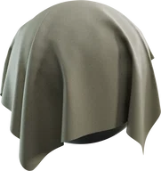</a> <b><a href="leather_white">Leather White</a></b> by Rob Tuytel · <a href="https://polyhaven.com/a/leather_white">source</a> |
| <a href="polar_fleece">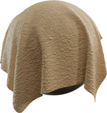</a> <b><a href="polar_fleece">Polar Fleece</a></b> by Rico Cilliers, colormass · <a href="https://polyhaven.com/a/polar_fleece">source</a> | <a href="poly_wool_herringbone">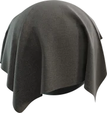</a> <b><a href="poly_wool_herringbone">Poly Wool Herringbone</a></b> by Rico Cilliers, colormass · <a href="https://polyhaven.com/a/poly_wool_herringbone">source</a> | <a href="quatrefoil_jacquard_fabric">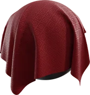</a> <b><a href="quatrefoil_jacquard_fabric">Quatrefoil Jacquard Fabric</a></b> by Rico Cilliers, colormass · <a href="https://polyhaven.com/a/quatrefoil_jacquard_fabric">source</a> | <a href="ribbed_corduroy">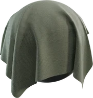</a> <b><a href="ribbed_corduroy">Ribbed Corduroy</a></b> by Rico Cilliers, colormass · <a href="https://polyhaven.com/a/ribbed_corduroy">source</a> |
| <a href="rough_linen">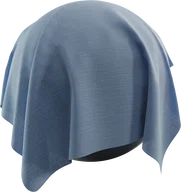</a> <b><a href="rough_linen">Rough Linen</a></b> by Rico Cilliers, colormass · <a href="https://polyhaven.com/a/rough_linen">source</a> | <a href="scuba_suede">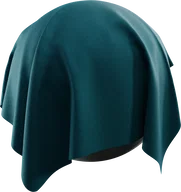</a> <b><a href="scuba_suede">Scuba Suede</a></b> by Rico Cilliers, colormass · <a href="https://polyhaven.com/a/scuba_suede">source</a> | <a href="stretch_poplin">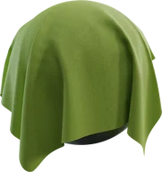</a> <b><a href="stretch_poplin">Stretch Poplin</a></b> by Rico Cilliers, colormass · <a href="https://polyhaven.com/a/stretch_poplin">source</a> |  <b><a href="tatami_mat">Tatami Mat</a></b> by Charlotte Baglioni · <a href="https://polyhaven.com/a/tatami_mat">source</a> |
| <a href="terlenka">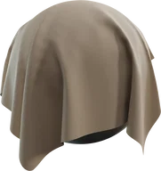</a> <b><a href="terlenka">Terlenka</a></b> by Rico Cilliers, colormass · <a href="https://polyhaven.com/a/terlenka">source</a> | <a href="terry_cloth">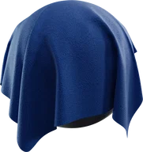</a> <b><a href="terry_cloth">Terry Cloth</a></b> by Rico Cilliers, colormass · <a href="https://polyhaven.com/a/terry_cloth">source</a> | <a href="velour_velvet">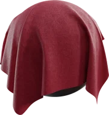</a> <b><a href="velour_velvet">Velour Velvet</a></b> by Rico Cilliers, colormass · <a href="https://polyhaven.com/a/velour_velvet">source</a> |  |

---

Kept up to date by this repository's own [update workflow](.github/workflows/update.yml), with code and plan from [cc0-mirror](https://github.com/zuujis-cc0/cc0-mirror). Something wrong? [Open an issue there](https://github.com/zuujis-cc0/cc0-mirror/issues/new) or use the [private report form](https://games.zuujis.com/report).
